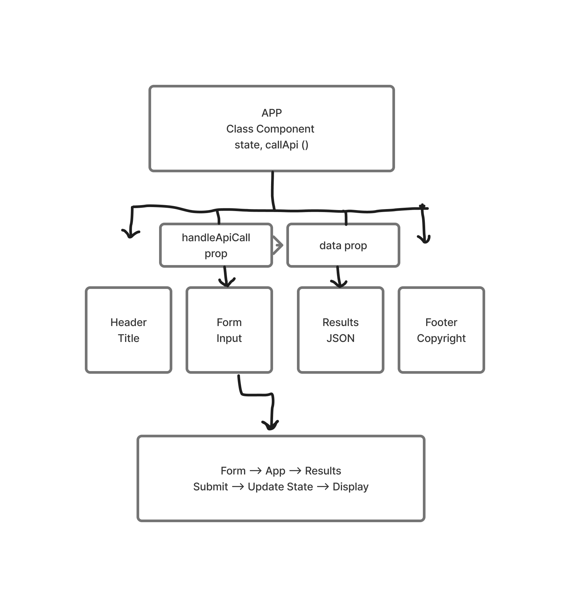

# RESTy — API Testing Application

## Code 401 — Labs 26–27: Component Based UI and useState

### Overview

RESTy is a React application designed to provide a user interface for testing REST API requests.

This project is the first phase of a four-phase application build.

In Lab 26, the primary objective is to establish the application's component structure and refactor the starter code from React class components into functional components.

### Technologies Used

- React
- Vite
- JavaScript / JSX
- Sass (SCSS)
- UUID
- Oxlint
- Git and GitHub
- Vitest
- React Testing Library

### Component Structure

- **App.jsx:** Main application container. Converted to a functional component in Lab 27 using useState to manage application data, request parameters, and loading.
- **Header:** Functional component displaying the application heading.
- **Footer:** Functional component displaying the footer.
- **Form:** Functional component containing the API request form and submitting data to App through props.
- **Results:** Functional component displaying formatted mock API results.

Each component has its own SCSS stylesheet.


### Lab 26 — Phase 1: Component Based UI

Lab 26 established the foundation of the RESTy application.

#### Features Implemented

- Created the RESTy application interface.
- Established reusable React components.
- Converted Header, Footer, Form, and Results into functional components.
- Provided a URL input field and HTTP method labels.
- Connected Form to App through a callback function.
- Managed request information using React class component state.
- Displayed formatted mock JSON response data.

### Lab 27 — Phase 2: useState Hook

Lab 27 builds on the component structure established in Lab 26.

The App component was converted from a class component into a
functional component using React's useState hook.

#### Features Implemented

- Converted App.jsx into a functional component.
- Used useState to manage response data, request parameters, and loading.
- Added interactive GET, POST, PUT, and DELETE method selection.
- Highlighted the selected HTTP method.
- Added a JSON request body textarea for POST and PUT.
- Submitted request information from Form to App.
- Displayed a Loading message during a simulated API request.
- Displayed formatted mock JSON results after loading.

**Note:** Lab 27 continues to use mock API responses.
Live API requests are planned for a later phase.


#### Automated Testing

Vitest and React Testing Library are used to verify:

- The RESTy heading renders correctly.
- A GET request can be submitted.
- The Loading message appears.
- Request information updates after submission.
- Mock JSON response data is displayed.

Run tests:

```bash
npm test
```

Build the application:

```bash
npm run build
```

#### Continuous Integration

GitHub Actions is configured in:

`.github/workflows/tests.yml`

The workflow runs automated tests and verifies the production build
when changes are pushed to main or state, or when a pull request
targets main.

#### AI Assistance Disclosure

ChatGPT was used as a learning and development assistant during Lab 27.

Assistance included:
- Explaining React useState and conditional rendering.
- Helping convert App into a functional component.
- Guiding implementation of HTTP method selection and loading state.
- Explaining Vitest and React Testing Library.
- Helping diagnose test failures and JavaScript syntax errors.
- Guiding GitHub Actions configuration and README documentation.

Example prompts included:
- "Does the placement look correct?"
- "Something is off the last line?"
- "Why yml?"
- "What's our ETA to finalize?"

All code changes were applied and tested locally by the developer.


### Installation

Clone the repository:

```bash
git clone git@github.com:metswin17/resty.git
```

Navigate into the project:

```bash
cd resty
```

Install dependencies:

```bash
npm install
```

Start the development server:

```bash
npm run dev
```

Open the local URL displayed by Vite.

### Testing and Verification

The application was manually tested in the browser to verify that:

- Components render successfully.
- The GO! button submits request information.
- App updates its state.
- Results displays formatted mock JSON.

Oxlint validation:

```bash
npx oxlint src
```

### Development Branches

- `state` — Lab 27 development branch
- `main` — Initial project branch
- `base` — Lab 26 development branch

### Author

GitHub: [metswin17](https://github.com/metswin17)

### UML Diagram

RESTy component structure and data flow.


